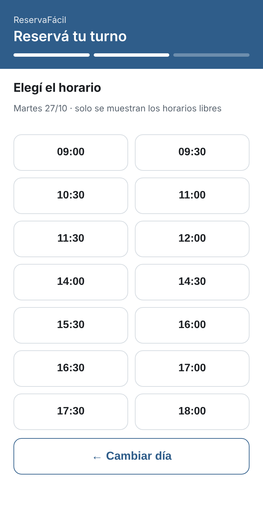
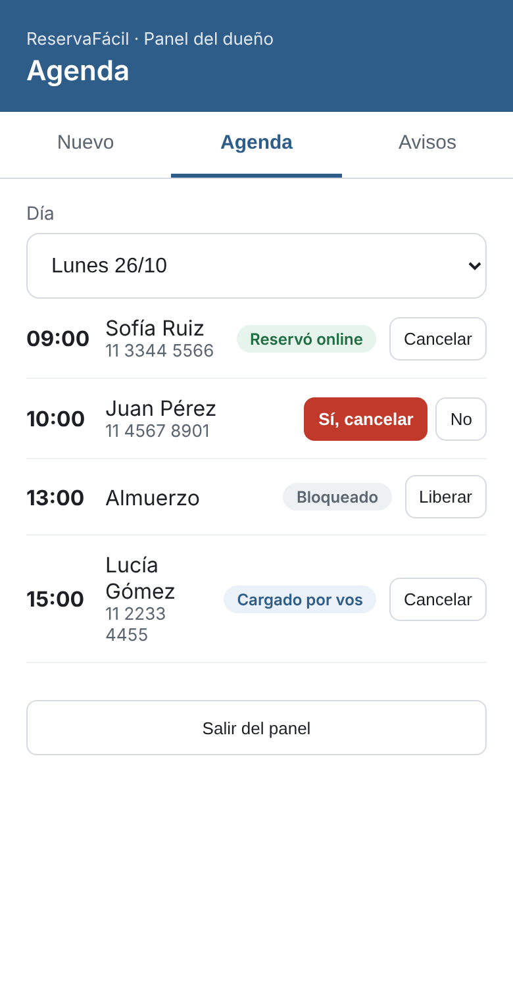
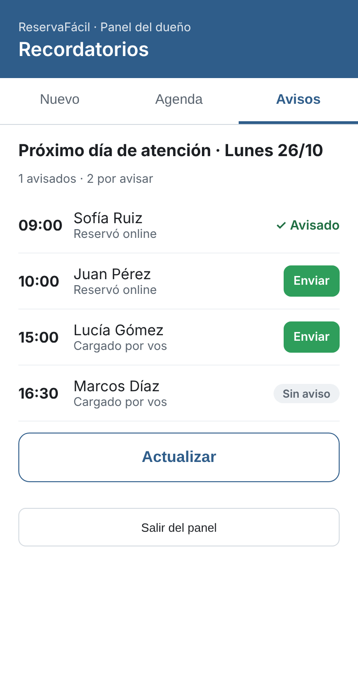
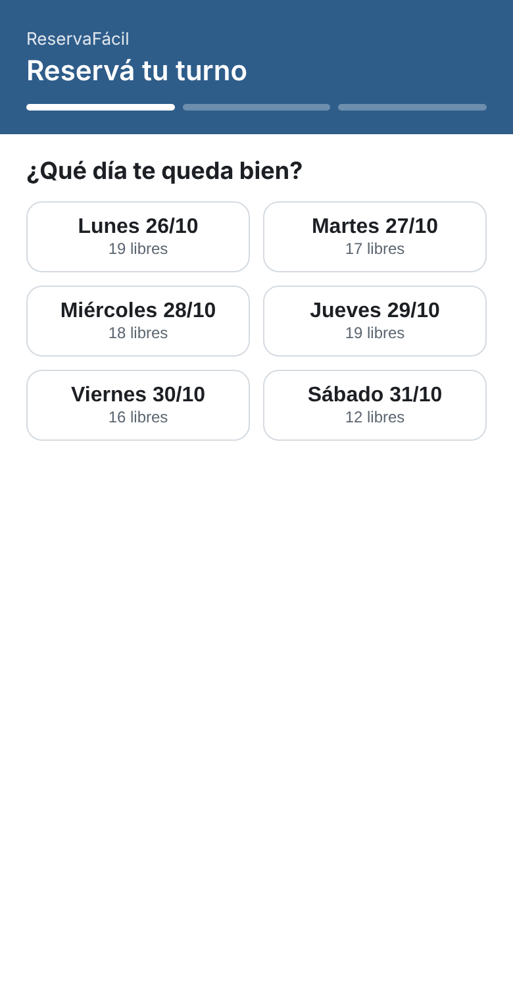
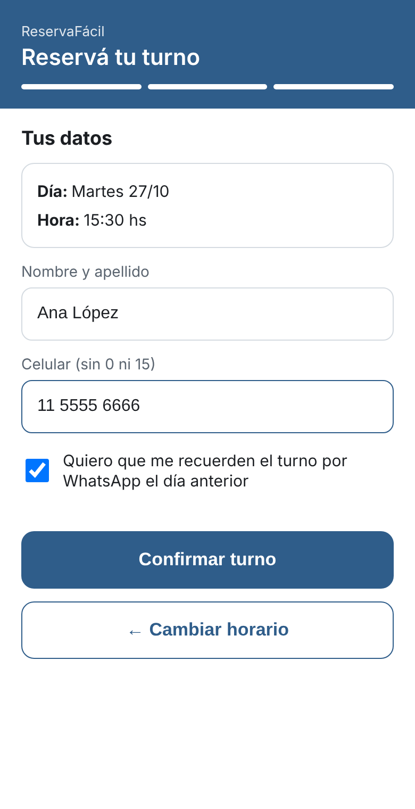
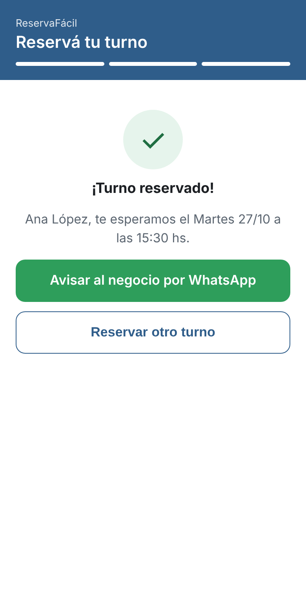
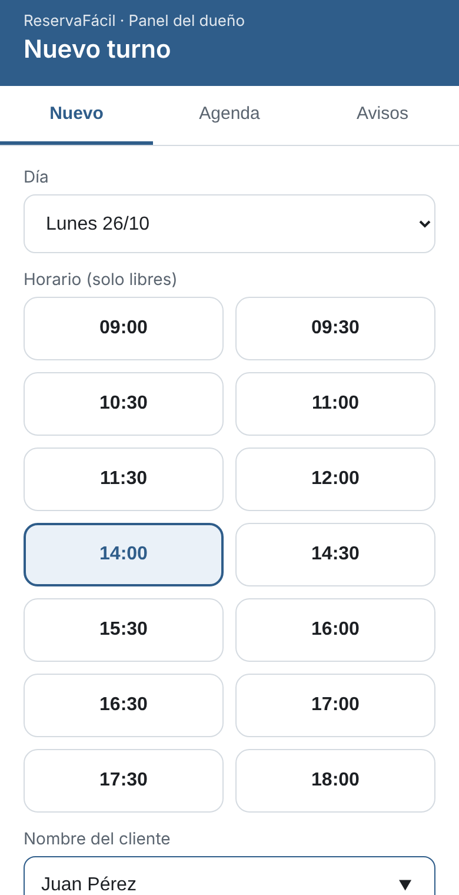
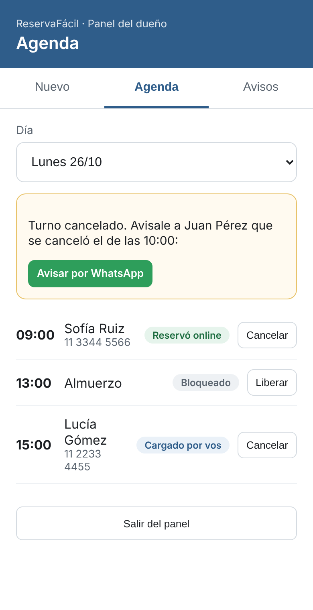
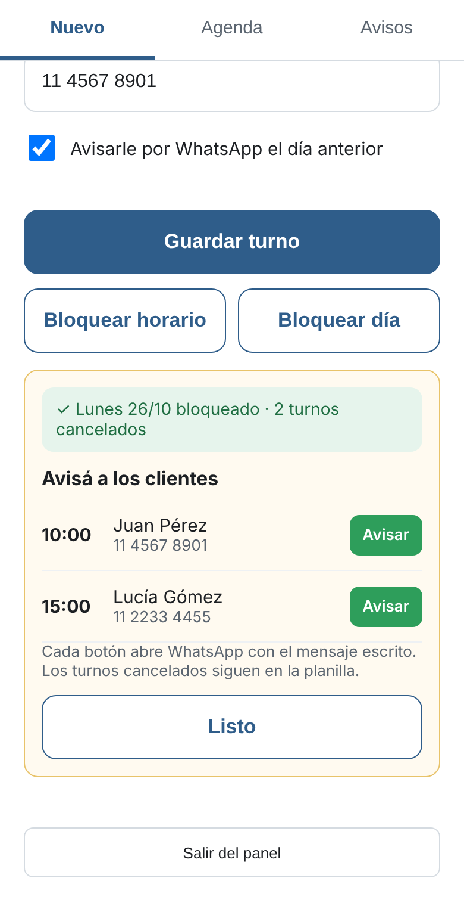

# ReservaFácil 📅

Sistema de turnos **gratis** para negocios chicos (peluquerías, barberías, consultorios, estética, profes particulares, etc.), hecho con **Google Sheets + Google Apps Script**, con recordatorios por **WhatsApp**.

El cliente reserva solo desde un link, en tres toques, sin descargar nada. El dueño ve la agenda en el celular y manda los recordatorios con un toque.

| Cliente reserva | Panel del dueño | Recordatorios |
|---|---|---|
|  |  |  |

---

## ✨ Funciones

### Página del cliente
- Reserva en **3 pasos**: día → horario → nombre y celular.
- Muestra **solo los horarios libres**: nunca se pueden dar dos turnos en el mismo horario.
- Si dos personas reservan el mismo horario al mismo tiempo, el sistema lo detecta y le avisa a la segunda.
- Respeta una **anticipación mínima** (por defecto, 2 horas).
- El cliente elige si quiere recibir el **recordatorio por WhatsApp** (consentimiento).
- Botón para avisarle al negocio por WhatsApp que reservó.

### Panel del dueño (con clave)
- **Nuevo turno**: carga turnos pedidos por teléfono o en persona. Autocompleta el celular de clientes que ya vinieron.
- **Bloquear horario** o **bloquear día completo**. Si ese día ya había turnos, permite cancelarlos y **avisarle a cada cliente por WhatsApp** con el mensaje escrito.
- **Agenda** por día con el origen de cada turno (online / cargado por el dueño / bloqueo). Cancelar con confirmación y aviso al cliente.
- **Avisos**: lista de turnos del próximo día de atención con botón **Enviar** que abre WhatsApp con el recordatorio armado, y marca de "✓ Avisado".

### Configuración sin tocar código
Desde la hoja `Config` de la planilla: nombre del negocio, primer y último turno, minutos por turno, días de atención, cuántos días para adelante se puede reservar, anticipación mínima, clave del panel y WhatsApp del negocio.

---

## 🛠️ Tecnologías

- **Google Apps Script** (JavaScript del lado del servidor)
- **HTML, CSS y JavaScript** (interfaz mobile-first, sin frameworks)
- **Google Sheets** como base de datos
- **Links `wa.me`** de WhatsApp (sin API paga)
- `LockService` para evitar reservas duplicadas simultáneas

**Costo de funcionamiento: $0.** Solo hace falta una cuenta de Gmail.

---

## 📁 Estructura

```
Codigo.gs        → Lógica del servidor: horarios libres, reservas, panel, avisos
Reservar.html    → Página pública para que el cliente reserve
Admin.html       → Panel del dueño (Nuevo / Agenda / Avisos)
Estilos.html     → Estilos compartidos
docs/            → Guía de instalación paso a paso
capturas/        → Imágenes de las pantallas
```

---

## 🚀 Instalación (≈15 minutos)

1. Crear una planilla en Google Sheets.
2. **Extensiones → Apps Script** y pegar los 4 archivos (`Codigo.gs` y los HTML `Reservar`, `Admin`, `Estilos`).
3. Ejecutar la función **`setup`** una vez y aceptar los permisos.
4. Completar la hoja **`Config`** (¡cambiar la clave!).
5. **Implementar → Nueva implementación → Aplicación web** (Ejecutar como: Yo · Acceso: Cualquier usuario).

Links resultantes:
- Clientes: `https://script.google.com/macros/s/…/exec`
- Dueño: `https://script.google.com/macros/s/…/exec?p=admin`

Guía completa: [docs/INSTALACION.md](docs/INSTALACION.md)

---

## 📸 Todas las pantallas

| | | |
|---|---|---|
|  |  |  |
|  |  |  |

---

## 👤 Autor

**Tahiel Cassata**, estudiante de la Tecnicatura Superior en Análisis de Sistemas.
